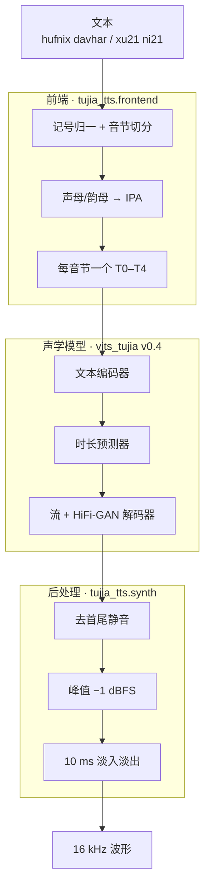
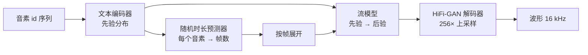

# 让土家语发出声音：一个 63 MB 的合成模型

> 技术与使用说明 · 2026-11
> 面向：技术 / 非技术 / 语言学 / 土家语爱好者 / AI 爱好者
> 版本：tujia-tts 0.4.0 · vits_tujia v0.4（正文的 v0.3 叙述保留原文，v0.4 见下方补记）

先给结论：**tujia-tts 不是「会说话的 AI」，而是一条把带调音节变成 16 kHz 波形的窄管线。** 它只认两种输入——Ye 拼音和带调 IPA——只输出一个声音（badou），不做翻译、不做汉字、不做多音色。真正决定「像不像土家语」的，一半在 6.40 小时语料，一半在前端怎样把音节拆成音素和调。

| 指标 | 数值 | 含义 |
|---|---|---|
| 3,958 | 训练片段数，合计 6.40 小时 | 单说话人，全部统一为 badou 音色 |
| 41 | 模型能输出的符号数 | 32 个音段 + 5 个调 token + 4 个控制符 |
| 0.690 | 40 句探针的合成音素错误率 | 同一套 ASR 下，真人录音是 0.567 |

## v0.4 补记（2026-11-22）

v0.4 是在 v0.3 基础上的**热启动微调**，不是重新训练。

| 项目 | v0.3 | v0.4 |
|---|---|---|
| 训练片段 | 3,958 / 6.40 h | 3,881 / 6.47 h（补 150 ms 尾静音、30 ms 首静音，峰值 -3 dBFS，剔除削波 72 条） |
| 初始化 | 从零 | 从 v0.3 ep69，lr 5e-5，训 60 轮，取 ep20 |
| val mel | 0.4523 | 0.4195 |
| ASR 错误率（100 句留出） | 0.973 | 0.972 |
| 音节时长中位（真人 222 ms） | 185 ms | 221 ms |
| 末尾 100 ms 能量 | 0.237 | 0.000 |

三件事值得记下来：

1. **重切路线被否掉。** 用页级对齐的切点重切、再转音色，两次独立训练都出现低频堆积（0–300 Hz 占比 0.45 以上）、ASR 错误率 ≥1.0；同一批音频只把标签从 T0 换成 T3，结论不变。问题在重切音频本身，不在标签。
2. **未标调统一按 21 处理。** v0.3 有 5.75% 的音节是 T0，模型只能猜调；v0.4 全部按 T3(21) 训练，前端默认值也改成 T3。
3. **微调比从头训练稳。** 同数据从零训练，6 次抽样里只有 2 次落到 0.88 的 ASR 错误率，其余 4 次都在 1.0 以上；热启动没有再出现这种发散。

代价是取舍：擦音持平（0.465 → 0.455），边音和鼻音略退（0.741 → 0.706 / 0.765 → 0.658），送气和不送气变好（0.556 → 0.634 / 0.793 → 0.814）。

---

## 01 读者地图

| 你是谁 | 建议读 | 你会得到 |
|---|---|---|
| 不懂技术，想知道能不能用 | 01、02、08、09 | 它解决什么问题、可靠到什么程度、哪里会出错 |
| 语言学者 / 记音工作者 | 03、06、07、10 | 音素表口径、声调表示、评测方法与边界 |
| 土家语爱好者 / 学习者 | 02、07、08、09 | 为什么它只认拼音、怎样输入、怎样判断合成是否可用 |
| AI / 语音方向从业者 | 04、05、06 | VITS 结构、16 ms 帧率的代价、导出与确定性 |
| 模型 / 开源爱好者 | 06、07、12 | 权重在哪、指标怎么读、两版之间差在哪 |

## 02 为什么这件事很难

土家语是低资源语言：使用人口不足十万，没有通行书写系统，没有公开发音词典，也没有成规模的标注语料。语音合成通常依赖的三样东西——大语料、标准正字法、多说话人覆盖——它一样都没有。

后果很直接。**没有标准音，就无法定义「像不像」。** 同一位说话人，两次录音的调值可能不同；不同调查点之间，同一个词的韵母可能记成 `-aŋ` 或 `-ã`。所以这个模型从第一天起就没有把「替代真人」当作目标，它的定位是**给已经写好的音节串配一个可听的发音**。

> **设计前提**
> 单说话人、单点口音、只吃拼音。模型不猜汉字、不猜词义、不做文语转换。这些「不做」不是能力不足，而是把有限的 6.4 小时全部集中在一个声音上——多音色会让平均音色既不像任何人，也不如任何一位原说话人清楚。

## 03 它到底是什么：三层职责

把系统拆开，只有三层。中间那层是模型，上下两层都是可读的代码。



**前端**负责把「人写的音节」变成「模型认识的 id」。音节切分、声母韵母解析、记法归一委托给 `tujia-nlp`；这个仓库只保留训练时的那张 41 符号表，以及「每个音节后面追加一个调 token」这条规则。

**模型层**是一个 VITS。它把音素序列先编码成隐变量，再用时长预测器决定每个音素占多少帧，最后由解码器一次性上采样成波形。

**后处理**是四个纯数字步骤：按 −40 dBFS 找到有声段、裁掉首尾静音、把峰值拉到 −1 dBFS、加 10 ms 淡入淡出。它不改变内容，只让输出在播放器里不炸耳、不拖尾。

## 04 从一行文本到一段波形

下面这条路径就是一次真实请求的执行顺序。注意每一步的数据形态：字 → 音节 → 音素 → id → 隐变量 → 采样点。

| 步骤 | 做什么 | 关键参数 / 依据 |
|---|---|---|
| 1 | 判断记法 | Ye 拼音含 `x/f/r/v` 或数字调；IPA 含调号/上标；可强制 `--notation` |
| 2 | 记号归一 | 词尾 `y`→`v`（53 调）、`*借词*2`、`bi2zi1ka3`、`A:` 标签 |
| 3 | 切音节、拆声母韵母 | `tujia-nlp`；`z/c/s/r + i → ɿ`，`-ng → ŋ` |
| 4 | 加调 token | 每个音节后接 `T0`–`T4`；未标调记 `T0` |
| 5 | 查表转 id | 41 符号表；查不到的音素**丢弃并计数**，不抛 `KeyError` |
| 6 | 编码 + 预测时长 | 16 kHz、hop 256，即 **16 ms 一帧** |
| 7 | 解码成波形 | 上采样 8×8×4，正好 256 倍 |
| 8 | 后处理 | 去静音 → 峰值归一 → 淡入淡出 |

第 5 步的「丢弃并计数」是刻意的：命令行会打印 `unknown: N`。如果这个数不是 0，说明你的拼写里有符号不在训练表内，合成结果会缺音——**先改拼写，再听音频**。

## 05 VITS 到底做了什么

VITS 解决的问题是：**文本和波形长度差几百倍，中间没有对齐标注。** 它的做法是把「对齐」变成模型内部的隐变量，用三个组件分工完成。



| 组件 | 职责 | 在本模型里的取值 |
|---|---|---|
| 文本编码器 | 把 id 序列变成逐音素的分布 | 41 个符号，无说话人通道 |
| 时长预测器 | 决定每个音素拉多长 | 随机时长预测器（SDP），导出时固定种子 |
| 流模型 | 把简单分布扭成复杂分布 | 若干耦合层，无 `sid` 条件 |
| 解码器 | 逐级上采样成采样点 | 8×8×4，初始 256 通道 |

**为什么导出这一步值得单独说。** VITS 的时长预测器带有随机采样：同一个音素，每次抽到的时长略有不同。v0.2 导出时这个随机节点的尺度被写成了常数，且不受 `noise_scale` 控制，结果是同一句话在不同进程里能差出 1.2–2.8 秒。v0.3 在导出后给该节点写死种子，噪声仍在、但每次抽到同一组——**同一文本、同一环境，输出字节一致**。这不是训练带来的改善，而是导出流程的修补。

## 06 做得怎么样：数字与边界

评测沿用 v0.2 的口径：40 条句级探针，每条先合成、再送进土家语 ASR，最后与目标 IPA 音素串算编辑距离。同一批探针的**真人录音**也要过一遍 ASR，它给出的是这套识别器的噪声下限。

| 指标 | v0.2 | v0.3 | 说明 |
|---|---|---|---|
| 验证集 mel 损失 | 0.5108 | **0.4523** | 训练目标，越低越好，但不等于更好听 |
| 合成音素错误率（中位） | 0.784 | **0.690** | 40 句探针，低 9.4 个点 |
| 真人音素错误率（中位） | 0.567 | 0.567 | ASR 自身下限，两版相同 |
| 时长稳定性 | 跨进程漂移 | **固定** | 同文本同进程输出一致 |

这张表要横着读。竖着看只能说明 v0.3 比 v0.2 好；横着看才知道它离「真人可被同一套 ASR 听懂」还差 12 个点。**这 12 个点就是模型现在的真实差距**，不是评测噪声。

> **一个反直觉的现象**
> 在更严格的 CTC 回听指标上，v0.3 的召回率只有一成多，删除错误接近一百处；但试听时它明显比上一版清楚。原因是那套指标把 ASR 的删除习惯也算在合成模型头上。**对这种低资源语言，人耳判断仍然优于单一自动指标**，所以发布口径用「合成 vs 真人」的差值，而不是绝对召回。

还有两个不在表里、但听得出来的问题：

| 现象 | 数值（合成 / 真人） | 原因 |
|---|---|---|
| 高频能量占比 | 0.177 / 0.104 | 解码器偏亮，齿音与气声被抬高 |
| 爆破密度 | 8.68 / 13.56 次每秒 | 16 ms 一帧比塞音爆发段粗，瞬态被抹平 |

**16 ms 是这套配置的硬约束。** hop 256 在 16 kHz 下就是每帧 16 毫秒，而一个塞音的除阻段往往只有几毫秒。模型能学到「这里该有个 p」，但学不到那个尖峰。要改这一点，得换更高采样率或更小 hop，代价是整条链路重训。

## 07 音素表与声调：41 个符号

模型的输出空间是固定的 41 个符号。理解这张表，就理解了它的能力边界。

| 类别 | 数量 | 内容 |
|---|---|---|
| 控制符 | 4 | `_`（blank）、`^`（句首）、`$`（句尾）、空格（词界） |
| 音段 | 32 | `a e i o u ã ĩ ũ ẽ ə ɛ ɤ j k l m n p s t w x y z ŋ ɿ ɕ ɣ ɲ ʂ ʈ ʰ` |
| 声调 | 5 | `T0`–`T4` |

声调 token 与实际调值的对应关系如下。注意 `T0` 不是第五个调，而是「**没有标调**」——输出时仍然占一个位置。

| token | Ye 调符 | 调值 |
|---|---|---|
| `T1` | `x` | 55 |
| `T2` | `f` | 35 |
| `T3` | `r` | 21 |
| `T4` | `v` | 53 |
| `T0` | 无 | 未标 |

有两个容易踩的坑。**第一，`T0` 不是中性调。** 它只是缺省值；如果一个音节本该有调而你漏写了，模型会按「无调」去合成，听感会短而平。**第二，41 个符号与 v0.1 不通用。** v0.1 的表里有 `õ`、没有 `ɣ`，两版的 `.onnx.json` 不能互换。

## 08 能做什么，不能做什么

**可以做**

- 把 Ye 拼音或带调 IPA 合成为 16 kHz 单声道语音
- 同一句重复合成，得到完全相同的时长与波形
- 用 `length_scale` 整体调快调慢，用 `noise_scale` / `noise_w` 调音色与韵律的随机度
- 在 CPU 上跑：整个模型 63 MB，无需 GPU
- 通过命令行、Python API、网页三种方式调用

**做不到**

- **不支持汉字**：没有文语转换，汉字输入会被丢弃
- **不翻译**：它不知道你写的音节是什么意思，只负责发音
- **只有 badou 一个声音**：不能换人、不能克隆
- **不建模连读变调**：每个音节的调照抄输入
- **不擅长单音节词**：短词最依赖韵律，也最容易听糊
- **爆破音偏软**：塞音瞬态被 16 ms 帧率抹平

如果只记一句话：**它是一个「把音标读出来」的工具，不是「会说话的助手」。**

## 09 三种用法

### 命令行

```bash
pip install tujia-tts

tujia-tts --text "hufnix davhar niev caif kax" -o out.wav
tujia-tts --text "xu21 ni21" -o out.wav --notation ipa
tujia-tts --text "af gov diex caf" -o a.wav --length-scale 1.1   # >1 更慢
```

输出会打印 `ids`、`unknown`、时长与峰值。**先确认 `unknown: 0`，再听音频。**

### Python API

```python
from tujia_tts import synthesize, write_wav

audio, sr, n_unknown, n_ids = synthesize("af gov diex caf")
write_wav("out.wav", audio, sr)
```

`audio` 是 16 kHz、`float32`、范围 [-1, 1]。需要自己控制后处理时，传 `do_postprocess=False`，再调用 `postprocess()`。

### 网页

打开创空间，输入拼音或 IPA，点「合成」。页面上有语速滑块和示例按钮。

```bash
# 本地
pip install -r space/requirements.txt
python3 space/app.py
```

网页端与命令行共用同一套前端和同一个 ONNX 文件，输出没有差别。

## 10 对语言学者意味着什么

这套工具最有价值的地方，不是「像不像真人」，而是**把「一个词该怎么念」变成可以反复播放、可以对比的对象**。

1. **输入是记音，不是汉字。** 你必须先决定音节和调，模型才会发音——这迫使记音先完成，避免「用汉字代替记音」的模糊。
2. **发音可重复。** 同一串音节每次得到同一段波形，便于做 A/B 对比，也便于把「我听到的」与「我记的」分开讨论。
3. **错误是可见的。** `unknown` 计数会直接告诉你哪个符号不在表内；缺音不会被悄悄吞掉。
4. **可做听辨实验。** 用同一句话的不同调值组合合成，请母语者判断哪一组可接受，比让发音人反复读更省力。

需要提醒的是：**它合成的是「这 6.4 小时语料里那个人的发音习惯」，不是「土家语的标准音」。** 把它当作一个不知疲倦的发音示范员，而不是发音标准。

## 11 五个常见误解

**「它能不能把中文翻译成土家语？」**
不能。翻译是 `tujia-llm` 的事；这里只负责把已经写好的音节读出来。

**「为什么我输入汉字没声音？」**
前端只识别 Ye 拼音与 IPA，汉字会被丢弃；全部丢弃时直接报错。

**「为什么同一句话两次合成听起来一样？」**
v0.3 的时长预测器固定了种子，这是刻意的。想听不同版本，调 `noise_scale` 或 `length_scale`。

**「模型是不是越大越好？」**
在这里不是。6.4 小时语料下，继续加参数只会更快过拟合；v0.3 的收益主要来自语料扩容与前端修正，而不是模型变大。

**「合成音能不能直接用于教学？」**
不建议未经校对就使用。声调是照抄输入的，连读变调没有建模；教学材料仍应由母语者过一遍。

## 12 资产与版本

| 资产 | 位置 | 说明 |
|---|---|---|
| 推理代码 | [github.com/ibaibing/tujia-tts](https://github.com/ibaibing/tujia-tts) | PyPI 包 `tujia-tts`，当前 0.4.0 |
| 代码镜像 | [gitee.com/xbaibing/tujia-tts](https://gitee.com/xbaibing/tujia-tts) | 国内访问 |
| 模型权重 | `TujiaNLP/tujia-tts-v0.3` | ONNX 63 MB + piper 风格配置 |
| 在线演示 | [创空间 tujia-tts-demo](https://modelscope.cn/studios/TujiaNLP/tujia-tts-demo) | 网页合成，随本版更新 |
| 版本说明 | `releases/tujia-tts-v0.4.md` | 与 v0.2 的逐项差异 |
| 训练数据 | 不公开 | 发布包只含推理权重与前端 |

模型权重与推理包一起分发：装 `tujia-tts` 就会带上 ONNX 文件，不需要另外下载。需要单独部署权重时，从 Hugging Face 或 ModelScope 取 `vits_tujia-v0.3.onnx` 与同名 `.onnx.json`，两者必须成对使用。

## Sources

1. ibaibing, tujia-tts — 推理代码、命令行与 Python API。 <https://github.com/ibaibing/tujia-tts>
2. Gitee 镜像 — tujia-tts（代码与文档，国内访问）。 <https://gitee.com/xbaibing/tujia-tts>
3. Hugging Face 模型 — tujia-tts-v0.3（ONNX 权重与配置）。 <https://huggingface.co/TujiaNLP/tujia-tts-v0.3>
4. ModelScope 模型 — tujia-tts-v0.3（国内模型托管）。 <https://modelscope.cn/models/TujiaNLP/tujia-tts-v0.3>
5. tujia-tts v0.4 发布说明 — 与 v0.3 的逐项差异与校验值。 <https://github.com/ibaibing/tujia-tts/blob/main/releases/tujia-tts-v0.4.md>
6. TujiaNLP — 语料、正字法与 `tujia-nlp` 前端依赖。 <https://github.com/ibaibing/TujiaNLP>
7. tujia-asr — 用于可懂度探针的反向识别管线。 <https://github.com/ibaibing/tujia-asr>
8. PyPI — tujia-tts 0.3.0。 <https://pypi.org/project/tujia-tts/>
9. ModelScope 创空间 — 在线合成演示。 <https://modelscope.cn/studios/TujiaNLP/tujia-tts-demo>
